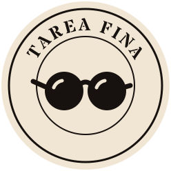

<p align="center"></p>

# Tarea Fina

Juego para jugar entre amigos, en persona: la app tira una frase al azar y hay que adivinar de qué tema y de qué disco es. Después se debate de dónde viene y se revela la respuesta.

Cubre la discografía de **Los Redondos** y de **Los Fundamentalistas del Aire Acondicionado**.

**Jugar:** https://lucaorpianesi5-prog.github.io/Tarea-fina/

## Cómo se juega

Elegí si querés frases de Los Redondos, de Los Fundamentalistas o de las dos, y un modo:

- **Libre:** tocá **Otra frase**, debatan de qué tema y disco es, y tocá **Revelar** para ver la respuesta. Los puntos se suman a mano.
- **Equipos (con timer):** el celu va en el medio y la pantalla se parte en dos, una mitad por equipo (la de enfrente aparece dada vuelta). Corre el tiempo y el equipo que toca primero su mitad frena el timer y responde en voz alta. Después se revela la respuesta y se marca si acertó: si acertó suma un punto. Si se acaba el tiempo, se revela y se pasa a la siguiente.
- **Jugadores (con timer):** igual, pero con un solo pulsador para todos. Quien frena lo marca en la lista de jugadores y responde.

Antes de arrancar, en los modos con timer se personaliza la partida:

- **Tiempo por frase:** de 10 a 60 segundos.
- **Dificultad:** en **Fácil** errar no resta; en **Difícil** errar resta un punto.
- **Fin de la partida:** sin final, **a puntos** (gana el primero que llega a 5, 10, 15 o 20) o **por frases** (se juegan 10, 20, 30 o 50 y gana el que tiene más puntos).

Si alguien toca sin querer, se puede seguir corriendo el timer. Si se sale a la pantalla principal en medio de una partida, el botón pasa a ser **Seguir partida**, con la opción de empezar una nueva.

No se repite ninguna frase hasta agotar la ronda.

## Frases del juego

Las frases base viven en [`data/frases.tsv`](data/frases.tsv) y las ve cualquiera que abra el link. Es un archivo de texto con una frase por fila y cinco columnas separadas por tabulaciones:

```
Banda	Disco	Año	Canción	Frase
```

- **Banda**: `Los Redondos` o `Los Fundamentalistas del Aire Acondicionado`.
- **Disco / Año / Canción**: tal como aparecen en el desplegable de la app.

Para agregar frases al juego de todos, editá ese archivo y subí el cambio.

### Cargar frases nuevas desde la app

El juego usa **solo** las frases de `data/frases.tsv`, así todos juegan con la misma base y sin repetidas.

Desde el botón **＋** se pueden cargar frases nuevas: quedan como **pendientes** en ese navegador y todavía no aparecen en el juego. Si una frase ya está en el repo (o ya está pendiente), la app avisa y no la duplica. Para que entren al juego, tocá **Copiar** en la caja de backup (trae las del repo más las pendientes, sin repetidas) y pegalo en `data/frases.tsv` reemplazando todo. Cuando la app ve que ya están en el repo, las saca de pendientes sola.

## Desarrollo

Es un único `index.html` (HTML + CSS + JS, sin dependencias ni build). Para probarlo en local hace falta servirlo por HTTP, porque el navegador no deja leer `data/frases.tsv` desde un archivo abierto directamente:

```bash
python3 -m http.server 8000
```

Después abrí http://localhost:8000.

## Aviso

Proyecto de fans, sin relación con las bandas ni con sus sellos. Las letras y las obras de arte pertenecen a sus autores.
